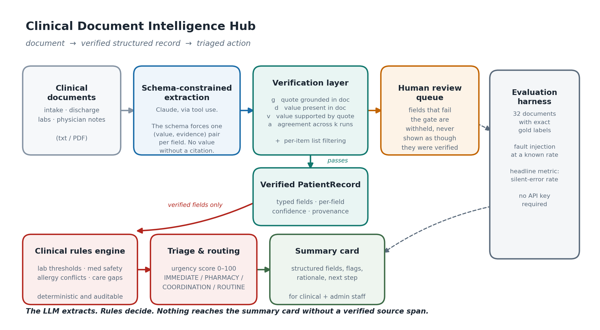

# Clinical Document Intelligence Hub

**Firstsource POC submission — Arman**

Unstructured clinical documents in, verified structured records out, triaged to the queue that should act on them.

The system reads intake forms, discharge summaries, lab reports and physician notes; extracts a typed patient record with a confidence and a source span on **every** field; applies a deterministic clinical rules engine; and routes the document with an urgency score and a stated reason.



---

## The design decision that drives everything

A clinical extraction demo is easy to make look good and hard to make trustworthy. The gap between the two is that **a value with no provenance cannot be checked** — a reviewer who wants to verify a lab result has to re-read the whole document, which is the manual work we claimed to remove.

So the pipeline is built around one rule: *nothing reaches the summary card without a verified source span.*

| Stage | Who does it | Why |
|---|---|---|
| Reading prose → structured fields | **LLM** (Claude, tool use) | Genuine reading-comprehension problem. Regex cannot do it on narrative notes. |
| Deciding a value is trustworthy | **Programmatic verification** | Self-reported confidence is poorly calibrated. Grounding is checkable. |
| Deciding a patient needs escalation | **Deterministic rules** | Clinical policy must be auditable, versionable, and reviewable. An LLM's failure mode here is a plausible-sounding wrong urgency. |

### Confidence is computed, not asked for

The model never scores itself. Each field's confidence is built from four measurable signals:

| Signal | Question |
|---|---|
| `g` grounding | Does the evidence quote actually exist in the source document? (fuzzy, OCR-tolerant) |
| `d` presence | Does the claimed **value** appear in the document, independent of its quote? |
| `v` support | Does the value appear inside the quote it cites? |
| `a` agreement | Across `k` samples, how often is the value identical? |

`confidence = 0.30·g + 0.25·d + 0.15·v + 0.30·a`

Two hard gates sit in front of the score. A quote that isn't in the document → `UNGROUNDED`. A **named entity** (patient, diagnosis, drug, allergen) whose value isn't in the document → `UNGROUNDED`, because a name that isn't in the text is an invention.

Numerics are deliberately *not* hard-gated on presence: `37.6 °C` correctly extracts as `99.7 °F` and `"one hundred and twelve"` as `112`, and neither literal appears in the text. Hard-gating those would punish the model for doing the conversion the schema asked for. Spelled-out numbers and Celsius equivalents are matched explicitly to recover most of these.

Below the abstention threshold, a field is **withheld** — moved into a review queue rather than shown with a quiet caveat.

### Lists are filtered per item

A medication list that is 4/5 correct is not 80% safe; the phantom fifth entry is the entire risk. Unsupported entries are removed individually and the field is flagged, rather than the list being accepted or rejected as a block.

---

## Results

Corpus: 32 synthetic documents — **17 structured forms, 15 free-prose narratives** — with exact gold labels. Full report in [`outputs/EVALUATION.md`](outputs/EVALUATION.md).

### Extraction, deterministic baseline arm

| Metric | Value |
|---|---|
| Silent error rate | **14.0%** |
| Precision of surfaced fields | 86.0% |
| Present fields missed | 177 / 470 |
| Document-type accuracy | 62.5% |

The baseline is a good-faith regex extractor over the common phrasings. It holds up on structured forms and **collapses on narrative prose** — which is the point of including narrative documents, and the honest measure of what the LLM arm is buying.

The document-type number is the clearest illustration. The baseline classifies by matching a literal header string, so a dictated note headed `CLINICAL NARRATIVE` or `WARD ROUND NOTE` falls through to a default and 12 of 32 documents are misfiled — before a single field has been read. Classification by keyword works right up until someone writes the document differently, which in a hospital is always.

### Verification layer, under fault injection

| Metric | Value |
|---|---|
| **Fabrication catch rate** | **96.2%** (50 / 52) |
| **False block rate** | **0.0%** (0 / 143 clean fields) |

The regex baseline cannot fabricate, so running it shows the verification layer doing nothing. To measure the layer honestly we inject synthetic hallucinations at a known rate: a genuine, correctly-copied evidence quote paired with a subtly wrong value — the failure mode that matters, because the citation looks perfect.

The two escapes are numeric corruptions whose perturbed value coincides with another number in the same document.

### Ingestion fidelity — text vs PDF vs scan

The same discharge summary through all four input routes. Plain text is the reference.

| Route | Detected as | Exact | OCR noise, same content | Entries dropped | **Invented** | Withheld | Risk flags |
|---|---|---|---|---|---|---|---|
| plain text | `text` | 16 | 0 | 0 | **0** | 0 | 10 |
| PDF, text layer | `pdf` | 15 | 0 | 0 | **0** | 1 | 10 |
| PDF, scanned (OCR) | `pdf-scanned` | 12 | 0 | 1 | **0** | 3 | 7 |
| image (OCR) | `image` | 10 | 1 | 1 | **0** | 4 | 7 |

**Invented entities across all four routes: 0.** What OCR costs is recall — three lab rows are lost (`HbA1c` transcribes as `HbAlc`, and the row is dropped rather than guessed at) and the flag count falls from 10 to 7 as a direct consequence. A flag that never fires cannot be reviewed, so that is a real loss. But nothing is fabricated to fill the gap.

Scoring the dropped rows as errors would have made OCR look like it invents lab results, which is both false and the wrong thing to engineer against. Regenerate with `python -m cdi.ingest_eval`.

### Headline metric: silent error rate, not accuracy

Of the fields the system actually put in front of a human, what fraction were wrong. A withheld field costs a reviewer thirty seconds. A confidently wrong field can propagate into a care decision. Averaging those two into one accuracy number hides the error that matters.

### Tests

```bash
python tests/test_pipeline.py      # 22 tests, no API key required
```

The suite covers the verification gates, the ingestion routes, and — most importantly — the **Anthropic arm**, which cannot otherwise be exercised without a key. `Extractor.extract()` is driven with a canned payload shaped exactly like a Claude `tool_use` response, so adjudication, abstention, per-item list filtering and self-consistency are all tested on the real code path. Separately, the tool schema is validated as JSON Schema, every field is asserted to structurally require an `evidence` span, and the live arm is asserted to fail *only* on missing credentials — never on a malformed schema or a bad model string. Everything except the network call is covered.

---

## Setup

```bash
python -m venv .venv && source .venv/bin/activate   # Windows: .venv\Scripts\activate
pip install -r requirements.txt
```

No API key is needed for the baseline arm, the full evaluation harness, or the UI.

For the LLM arm:

```bash
export ANTHROPIC_API_KEY=sk-ant-...      # Windows: set ANTHROPIC_API_KEY=sk-ant-...
```

## Running it

```bash
# Interactive demo
streamlit run app.py

# Single document to the console -- text, PDF, scanned PDF or image
python -m cdi.summarize data/demo/DEMO_discharge_summary.txt
python -m cdi.summarize data/demo/DEMO_discharge_summary.pdf
python -m cdi.summarize data/demo/DEMO_discharge_summary_scan.png
python -m cdi.summarize data/documents/DOC018.txt --arm anthropic --json

# Evaluation
python run_eval.py                          # baseline + fault injection, no key needed
python run_eval.py --arm anthropic --k 3    # LLM arm with self-consistency
python run_eval.py --arm both

# Regenerate the corpus and the PDF/scan fixtures (seeded, reproducible)
python cdi/corpus.py
python assets/make_fixtures.py

# Tests
python tests/test_pipeline.py
```

### Optional: OCR

Image and scanned-PDF input needs Tesseract. Everything else runs without it.

```bash
sudo apt install tesseract-ocr     # macOS: brew install tesseract
pip install pytesseract
```

Without it, text and text-layer PDFs work normally; a scan raises a clear error naming the missing dependency rather than returning an empty document.

## Layout

```
cdi/schema.py      typed record; every field carries confidence + provenance
cdi/ingest.py      text / PDF / scanned-PDF / image, with provenance and OCR detection
cdi/extract.py     Anthropic tool-use extractor + deterministic regex control arm
cdi/verify.py      grounding, presence, support, agreement; gates and abstention
cdi/reason.py      clinical rules: lab thresholds, med safety, allergy conflicts, care gaps
cdi/evaluate.py    metrics: silent error rate, abstention, per-field P/R/F1
cdi/inject.py      fault injection to measure the verification layer without an API key
cdi/corpus.py      seeded synthetic corpus generator + gold labels
cdi/ingest_eval.py what each ingestion route costs, measured
cdi/summarize.py   console renderer
tests/             22 tests, including the LLM path via a canned tool-use payload
app.py             Streamlit UI
run_eval.py        consolidated evaluation report
```

---

## Worked example

**Input** (`outputs/sample_input.txt`, abridged) — a discharge summary containing four traps: prior-visit vitals, a family-history condition, a discontinued drug, and a prescription that conflicts with a documented allergy.

```
Patient Name : Margaret Ellison
Age / Sex    : 71 / F

VITALS
  B/P 186 over 104 mmHg   Pulse rate ...... 118 bpm   SpO2 ...... 91%
  (At last visit 6 weeks ago: BP was 138/82, pulse 74.)

Active Problem List:
  1. Congestive Heart Failure
  2. Chronic Kidney Disease Stage 3
  Family history of Atrial Fibrillation (mother) - not active for this patient.

CURRENT MEDICATIONS
  - Metformin 1000 mg BD
  - Amoxicillin 500 mg TDS
  [Discontinued last month: Ibuprofen - do not resume]

Known allergies:
  Penicillin - reaction: rash

LAB DATA
  Potassium .......... 5.9 mmol/L        eGFR .......... 24 mL/min/1.73m2

No follow-up appointment arranged.
```

**Output** (`outputs/sample_output.txt`, abridged)

```
  Routed to  : IMMEDIATE CLINICAL REVIEW
  Urgency    : 100/100

  Blood pressure  : 186 [1.00] / 104 [1.00] mmHg      <- not the prior-visit 138/82
  Diagnoses       : CHF; T2DM; CKD Stage 3            <- family-history AF excluded
  Medications     : Metformin, Furosemide,
                    Lisinopril, Amoxicillin           <- discontinued Ibuprofen excluded

  RISK FLAGS (10)
    [CRITICAL] Prescribed drug conflicts with documented Penicillin allergy
                 rule SAFETY.allergy_conflict  |  allergy=Penicillin, drug=amoxicillin
    [CRITICAL] Metformin contraindicated at eGFR < 30
                 rule MED.metformin_egfr  |  metformin, eGFR=24.0
    [CRITICAL] Hypertensive crisis range        |  BP=186/104
    [HIGH]     Potassium-raising drug with elevated potassium  |  lisinopril, K=5.9
    [HIGH]     High-risk diagnosis discharged with no follow-up documented

  RECOMMENDED NEXT STEP
    Escalate to on-call clinician now.
```

The allergy conflict and the metformin contraindication are the kind of finding that justifies the system: both are visible in the source document, neither is visible to a human skimming four pages under time pressure.

---

## Assumptions and limits

- **Synthetic data.** No real or proprietary clinical data was used. Templated generation is the only way to get exact gold labels for free, and it flatters any extractor built by the same person who wrote the templates. The narrative arm exists to blunt that, but a real corpus (MIMIC-style, with IRB cover) would move these numbers and is the first thing I'd change.
- **The rules are illustrative.** Thresholds follow widely used adult reference and critical-value conventions and standard label contraindications. They are a prototype's rules and would need clinical governance sign-off before touching a real workflow.
- **Ingestion is implemented but shallow.** Text, text-layer PDF, scanned PDF and image all work, and a scan is detected rather than silently returned empty. But OCR quality is whatever Tesseract gives at default settings — no deskewing, no preprocessing, no layout reconstruction. Multi-column and tabular scans would need real document-layout handling.
- **No PHI handling.** De-identification, audit logging, access control and data residency are all absent and all mandatory for anything real.
- **Confidence is calibrated by construction, not by fitting.** The four weights are chosen, not learned. With a labelled confidence dataset they should be fit, and the abstention threshold set from a cost curve rather than picked at 0.70.

## Questions I'd expect, answered

**"You wrote the corpus *and* the extractor you measure against it. Isn't that circular?"**
Yes, and it showed. My first evaluation gave the regex baseline 99.4%, because I had authored both the document templates and the patterns that parse them. The narrative arm — 15 documents in free prose, numbers spelled out, temperature in Celsius, no field labels — exists specifically to attack that. It dropped the baseline to 86% surfaced precision and 62.5% document-type accuracy. It is a mitigation, not a fix. The fix is a corpus I did not write, which is the first item below.

**"The abstention threshold is 0.70. Why?"**
Because I picked it. That is the weakest number in the system. It should be derived from an explicit cost ratio — what the organisation decides a missed field costs relative to a wrong one — and set from the resulting curve. The four confidence weights are similarly chosen rather than fitted; with a labelled confidence set they should be learned.

**"Your injected hallucinations aren't real hallucinations."**
Correct, and `cdi/inject.py` says so in its docstring. The injection models one specific failure mode: a genuine, correctly-copied evidence quote paired with a subtly wrong value. I picked it because it is the mode a citation-based defence is *least* likely to catch, so 96.2% is intended as a lower bound rather than a headline. Real model errors have a different distribution and would need measuring against the live arm.

**"Why are the clinical rules not the LLM? Wouldn't it reason better?"**
It might reason more flexibly, and that is the problem. Deciding a potassium of 5.9 warrants escalation is policy, not comprehension — it must be auditable, versionable, and reviewable by a clinician who does not trust the model. A rule fires identically every time and traces to a threshold in a table. An LLM's failure mode here is a plausible-sounding wrong urgency, which is precisely the error nobody catches. The LLM does the part that is genuinely a reading problem; rules do the part that is genuinely a policy problem.

**"Only 62.5% document-type accuracy?"**
That is the *baseline* arm, and it is the clearest illustration of why the baseline is a control rather than a proposal. It classifies by matching a literal header string, so a dictated note headed `CLINICAL NARRATIVE` falls through to a default. Twelve of 32 documents are misfiled before a single field is read.

## If I had another week

1. Fit the abstention threshold against an explicit cost ratio for a missed field vs. a wrong field, instead of a hand-picked 0.70.
2. Field-level routing — send only the low-confidence fields to a second, stronger model rather than re-running the whole document.
3. Replace the templated corpus with a public de-identified one and re-measure; report the delta honestly.
4. Multi-document patient view: reconcile an intake form against a discharge summary and flag contradictions between them.
5. Latency and cost per document, which this prototype does not measure at all.
